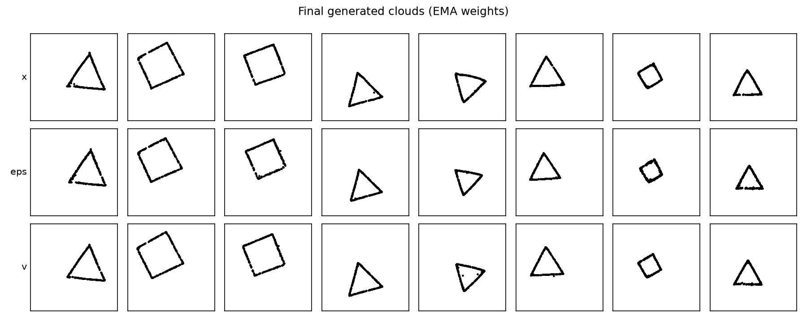

# Flow Matching with DiT for 2D point clouds

Part of the DLCV project lab "Back-to-Basics for Point-cloud Generation". A DiT is trained with flow
matching to generate 2D point clouds of simple shapes, comparing three prediction targets: the clean
cloud (x), the noise (eps) and the velocity (v). The main score is the Chamfer distance.

## Dataset (`shapes.py`)

| | |
|---|---|
| shapes | triangle, square, circle (taking turns, so every split is balanced) |
| points per cloud | 256, at random positions along the **outline** of the shape |
| base size | every shape fits exactly in the unit circle (circle radius 1, polygon corners on it) |
| random rotation | 0 to 360 degrees (`--no-rotate` to turn off) |
| random size | factor 0.5 to 1.0 (`--scale_min 1 --scale_max 1` to turn off) |
| random position | shift of up to 0.5 along x and along y (`--shift 0` to turn off) |
| splits | 10,000 training clouds (seed 0), 300 held-out reference clouds (seed 1000) |

All coordinates lie in [-1.5, 1.5]. The model is unconditional: it never sees the shape labels.
They are only used to count which shapes the model generates.

## The model (`dit.py`)

The DiT from the image experiments, changed for point clouds:

- **Each point is a token.** A linear layer turns its (x, y) into a 384-dimensional vector (no patches).
- **No position embeddings.** A point cloud is a set, so the order of its points must not matter.
  Without position embeddings, shuffling the input points shuffles the output the same way.
- **The output is one 2D vector per point.**
- Kept from DiT: sine-cosine time embedding, adaLN-Zero blocks, conditioned final layer.
  Default size as DiT-S: 12 blocks, width 384, 6 heads.

## Flow matching (`flow_matching.py`)

`x_t = (1 - t) * noise + t * cloud`, so t = 0 is noise and t = 1 is the cloud. The velocity is
`cloud - noise`. The model outputs x, eps or v, which is converted to a velocity (x:
`(output - x_t) / (1 - t)`, eps: `(x_t - output) / t`, both denominators clamped at 0.05), and the
loss is the squared error to the true velocity. Generation follows the velocity from noise to t = 1
with Euler or Heun steps.

## Scores (`metrics.py`)

- **Chamfer distance (CD)** between two clouds: for every point, the squared distance to the closest
  point of the other cloud, averaged, in both directions and added. 0 = the same set of points.
- **1-NNA** (main score for full training): mix the generated and the real held-out clouds; for each
  cloud, check whether its closest other cloud (by CD) comes from the same set. 0.5 = the two sets
  cannot be told apart (best), 1.0 = always told apart (worst).
- **MMD-CD:** for every real cloud, the CD to the closest generated cloud, averaged. Lower = better.
- **COV-CD:** share of real clouds that are the closest match of at least one generated cloud. Higher = more variety.
- **Shapes:** each generated cloud gets the shape of its closest real cloud. Roughly equal counts = no shape is missing.
- **Overfitting:** CD from each generated cloud to the closest training cloud, and how many training clouds appear.

## Files

| file | what it does |
|---|---|
| `shapes.py` | the toy dataset; `python shapes.py` saves `dataset_examples.png` |
| `dit.py` | the point-cloud DiT |
| `flow_matching.py` | mixing with noise, the x/eps/v conversion, the loss, Euler and Heun samplers |
| `metrics.py` | Chamfer distance, 1-NNA, MMD, COV |
| `train.py` | trains one prediction type with EMA weights; scores and plots samples at every checkpoint |
| `evaluate.py` | re-scores saved checkpoints with different samplers and step counts |
| `compare.py` | charts and a table comparing finished runs |
| `check.py` | quick checks that the pieces fit together |
| `baseline.py` | real-vs-real baseline: the scores a perfect generator would get |
| `shape_fit.py` | fits a true triangle, square and circle to each cloud: shape shares and outline accuracy |
| `run_overfit.sh` | sanity check: overfit 3 clouds with x, eps and v |
| `run_all.sh` | full training with x, eps and v, then evaluation and charts |

## Running (on the lab machine)

```bash
cd ~/projects/pcg/pointcloud-dit
conda activate pcg
python check.py                      # seconds
python shapes.py                     # look at dataset_examples.png
tmux new -s pc                       # keeps running if the connection drops (leave: Ctrl+B, then D)
bash run_overfit.sh 2>&1 | tee run_overfit.log
bash run_all.sh 2>&1 | tee run_all.log
```

## Default training settings

| | overfit check | full training |
|---|---|---|
| data | 3 clouds (one per shape) | 10,000 clouds |
| model | DiT-S size, 12 blocks, width 384 | same |
| batch | 64 random picks | 64 |
| steps | 3,000 | 20,000 |
| optimizer | Adam, lr 3e-4 | Adam, lr 1e-4 |
| EMA decay | 0.99 | 0.999 |
| gradient clipping | 1.0 | 1.0 |
| time sampling | uniform t in [0, 1] | same |
| sampling | Euler, 50 steps | same |
| scored at each checkpoint | 30 generated clouds vs the 3 training clouds | 300 generated vs 300 held-out clouds |

## Results

Full training on 10,000 clouds for 20,000 steps per prediction type, one training seed each. Scores use
the EMA weights and Heun with 200 steps, averaged over 3 noise seeds (300 generated clouds per seed).



### Chamfer scores against 300 held-out clouds

| | 1-NNA | MMD-CD | COV-CD |
|---|---|---|---|
| real vs real (`baseline.py`) | 0.473 +- 0.018 | 0.01719 +- 0.00049 | 0.594 +- 0.022 |
| v | 0.481 | 0.01815 | 0.59 |
| x | 0.499 | 0.01838 | 0.58 |
| eps | 0.515 | 0.01944 | 0.58 |

The real-vs-real row is what a perfect generator would get with 300 clouds.

### Shape fit (`shape_fit.py`)

| | triangle / square / circle % | distance to outline | points off outline | clean clouds | outline covered | size |
|---|---|---|---|---|---|---|
| real clouds | 33.3 / 33.3 / 33.3 | 0.00031 | 0.00 % | 99.0 % | 99.67 % | 0.751 |
| v | 30.4 / 35.2 / 34.3 | 0.00515 | 1.49 % | 66.8 % | 99.62 % | 0.750 |
| eps | 35.1 / 34.3 / 30.6 | 0.00657 | 3.26 % | 43.2 % | 99.54 % | 0.733 |
| x | 30.0 / 36.2 / 33.8 | 0.00731 | 5.40 % | 37.8 % | 99.23 % | 0.761 |

The check names the correct shape for 100 % of real clouds. "Points off outline" are further than 0.02
from the fitted outline. "Clean clouds" fit as well as 99 % of the real clouds.

### Findings

- All three prediction types generate the three shapes without labels, with variety close to real data.
- v gives the cleanest outlines, followed by eps and then x.
- MMD and COV are close to the real-vs-real limit and barely separate the models; the shape fit does.
- No model reaches the outline accuracy of real clouds yet.
- The "Shapes" count in `metrics.py` names the correct shape for only 71 % of real clouds, so use the
  shape fit for shape shares.
- Each prediction type was trained with one seed, so the order of eps and x is not yet confirmed.

### Overfit check

Three clouds, 3,000 steps: nearest CD (EMA) x 0.00033, v 0.00090, eps 0.00478. All 3 training clouds were
reproduced by every prediction type.
